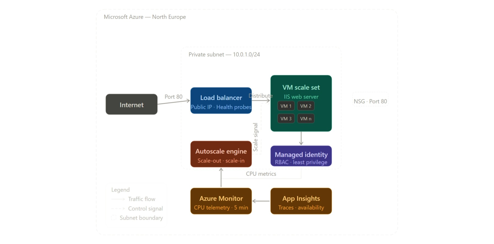
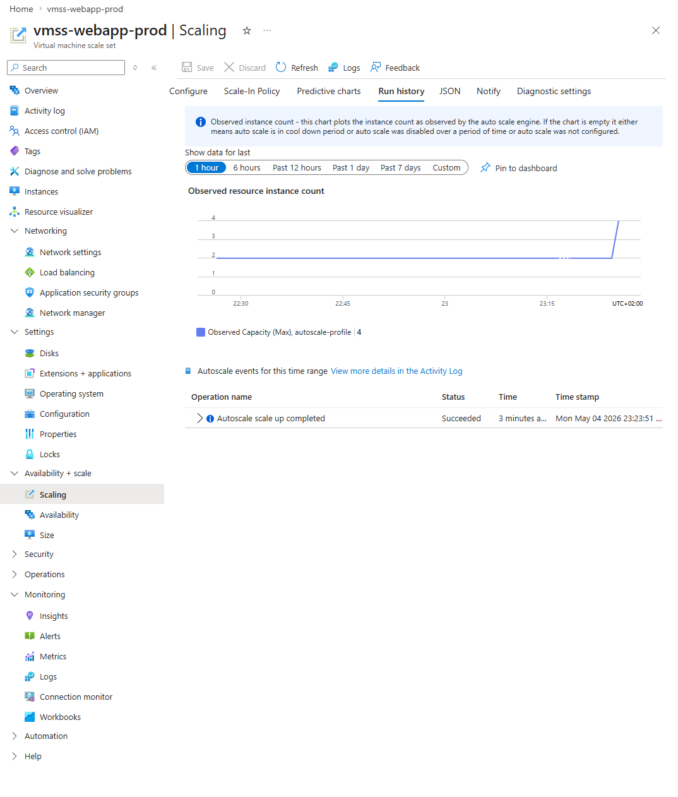

# Elastic Web App: VM Scale Set with Autoscale on Azure

A web server farm that grows and shrinks with CPU load. Ubuntu VMs running nginx sit in a VM Scale Set behind an Azure Load Balancer, and Azure Monitor autoscale adds or removes instances. Everything is built with Terraform; a PowerShell script generates load to test it.

Based on the cloud labs from [mzazon/cloud-projects](https://github.com/mzazon/cloud-projects).



## How it works

- `networking.tf`: virtual network, private subnet for the instances, NSG that lets the Load Balancer health probe reach port 80.
- `compute.tf`: VM Scale Set (Ubuntu 22.04, `Standard_D2s_v3`, 2 instances to start). nginx is installed at boot through `custom_data`.
- `load_balancer.tf`: public Load Balancer with a health probe, so traffic only goes to healthy instances. Only the Load Balancer has a public IP.
- `monitor.tf`: autoscale between 2 and 10 instances. Scale out by 2 when average CPU is above 0.2% for 1 minute, scale in by 1 when it is below 30% for 5 minutes, 5 minute cooldown. The scale-out threshold is set very low on purpose, because my test load could not push the VMs much higher. There is also an alert at 80% CPU and Application Insights.
- `scripts/test-scaling.ps1`: reads the outputs from Terraform, sends a few test requests to the Load Balancer, then starts 20 background jobs that keep sending requests to create load.

## Run it

You need the Azure CLI (`az login`), Terraform and PowerShell.

```bash
cd code/terraform
terraform init
terraform plan
terraform apply
cd ..
pwsh scripts/test-scaling.ps1     # run from the folder with the Terraform state
```

Watch the instance count and the autoscale run history in the Azure portal. Remove everything with `terraform destroy`.



## Problems I ran into

- **Health probe marked every instance as unhealthy.** The NSG blocked port 80 from the Load Balancer. I allowed it from the `AzureLoadBalancer` service tag.
- **No VM size available in my first regions.** I tried several sizes and regions before `Standard_D2s_v3` in North Europe worked.
- **Autoscale never triggered.** My load test could not raise CPU enough, so I lowered the threshold and shortened the time window to prove that scaling works.

## What I learned

- How a Load Balancer health probe decides where traffic goes.
- How autoscale rules, time windows and cooldowns interact.
- Cleaning up between deployments avoids errors from leftover resources.
